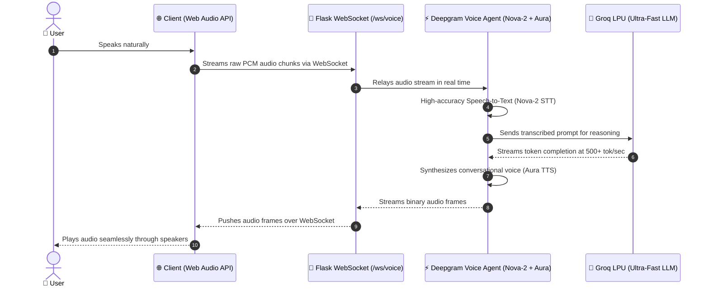

# 🎙️ Real-Time Conversational Voice AI Agent

[](https://www.python.org/)
[](https://deepgram.com/)
[](https://groq.com/)
[-010101?style=for-the-badge&logo=socketdotio&logoColor=white)](https://github.com/pallets-eco/flask-sock)
[](https://flask.palletsprojects.com/)
[](LICENSE)

A production-grade, ultra-low-latency **Real-Time Conversational Voice AI Agent** capable of near-instant voice-to-voice dialogues. Powered by **Deepgram's Voice Agent API** (Nova-2 STT & Aura TTS), **Groq's LPU Inference Engine** (500+ tokens/sec LLM reasoning), and bidirectional **WebSockets** for fluid, full-duplex human-to-AI spoken conversations.

---

## ⚡ Architecture & Low-Latency Pipeline

The system bridges client-side browser microphones directly to cloud inference streams with zero audio file disk buffering:



---

## 🚀 Key Highlights & Capabilities

- **Sub-Second Voice-to-Voice Latency**: Combines Deepgram's streaming STT/TTS with Groq's high-throughput LPU inference to achieve realistic, conversational dialogue speed without awkward pauses.
- **Full-Duplex WebSocket Audio Bridge**: Custom `/ws/voice` gateway built on `flask-sock` handling bidirectional binary audio frames, user transcripts, and agent events.
- **Hybrid Intelligence Architecture**:
  1. **Instant Command Matcher (`/api/command`)**: Token-aware weighted scoring engine matching intents locally against `data/knowledge.json` for zero-latency system navigation (YouTube, Google, navigation).
  2. **Groq LLM Fallback**: Open-ended questions seamlessly route to Groq's high-speed inference engine for deep reasoning.
- **Dynamic Hot-Reloading (`/api/reload`)**: Update and reload the knowledge base JSON at runtime without restarting the Flask daemon.
- **Modern Responsive Web GUI**: Browser interface featuring real-time audio visualization, live user speech transcription, agent response text, and manual text input controls.

---

## 📂 Project Structure

```
project-2/
├── project 2/
│   ├── app.py               # Main Flask server & WebSocket voice agent bridge
│   ├── commands.py          # Token-aware weighted intent scoring engine
│   ├── requirements.txt     # Production dependencies
│   ├── data/
│   │   └── knowledge.json   # Intent database & structured command actions
│   └── templates/
│       └── index.html       # Web interface with Web Audio API recording & playback
└── README.md                # Project documentation & architecture
```

---

## 🛠️ Tech Stack & Dependencies

| Layer | Technology | Purpose |
| :--- | :--- | :--- |
| **Speech-to-Text (STT)** | **Deepgram Nova-2** | Real-time streaming speech transcription with domain formatting. |
| **LLM Inference** | **Groq LPU Engine** | Ultra-low latency conversational intelligence. |
| **Text-to-Speech (TTS)** | **Deepgram Aura** | Human-like, natural voice synthesis with zero robotic tone. |
| **Streaming Gateway** | **WebSockets (`flask-sock`)** | Bidirectional binary audio streaming between browser and cloud. |
| **Web Server** | **Flask 3.0** | HTTP REST endpoints and static UI serving. |
| **Environment & Config** | `python-dotenv` | Secure API credential management. |

---

## 🚀 Quickstart & Setup Guide

### 1. Clone the Repository
```bash
git clone https://github.com/uniqabhishek/project-2.git
cd "project-2/project 2"
```

### 2. Set Up Virtual Environment
```bash
python -m venv venv

# On Linux/macOS:
source venv/bin/activate

# On Windows:
venv\Scripts\activate
```

### 3. Install Dependencies
```bash
pip install -r requirements.txt
```

### 4. Configure Environment Variables
Create a `.env` file inside the `project 2/` directory:
```env
DEEPGRAM_API_KEY="your_deepgram_api_key_here"
GROQ_API_KEY="your_groq_api_key_here"
```

> **Get Free API Keys**:
> - Deepgram: [console.deepgram.com](https://console.deepgram.com/) (Includes free credit)
> - Groq: [console.groq.com](https://console.groq.com/) (High-speed free tier)

### 5. Start the Voice AI Agent
```bash
python app.py
```
Open `http://localhost:5000` in your browser, allow microphone access, and speak directly to your Voice AI Agent!

---

## 📡 API & WebSocket Reference

### 1. `/ws/voice` (WebSocket)
- **Protocol**: `ws://` or `wss://`
- **Payloads**:
  - `Browser ➔ Server`: Raw binary audio chunks (PCM / WebM / Opus).
  - `Server ➔ Browser`:
    - `{"type": "transcript", "transcript": "...", "role": "user"}`
    - `{"type": "audio", "data": "<base64_audio_frame>"}`

### 2. `POST /api/command`
- **Body**: `{"command": "search for quantum computing on YouTube"}`
- **Response**:
  ```json
  {
    "text": "Searching YouTube for quantum computing",
    "open_url": "https://www.youtube.com/results?search_query=quantum+computing",
    "intent": "youtube_search",
    "confidence": 0.95,
    "exit": false
  }
  ```

---

## 👨‍💻 Author

**Abhishek**  
- **GitHub**: [@uniqabhishek](https://github.com/uniqabhishek)  
- **Flagship Project**: [TradeMind AI Workspace](https://uniqabhishek.github.io/Trading-Journal/)
